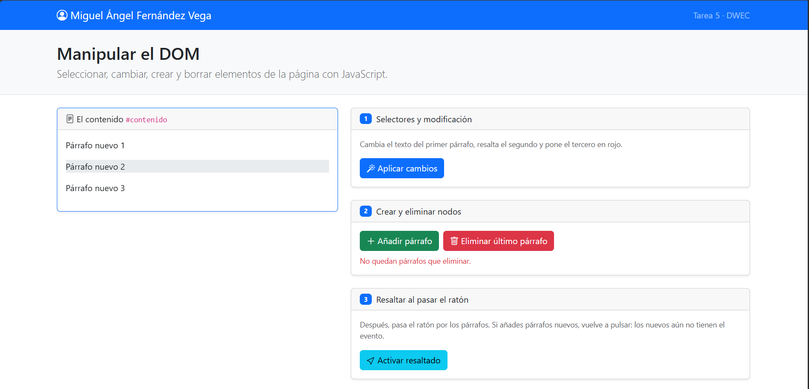
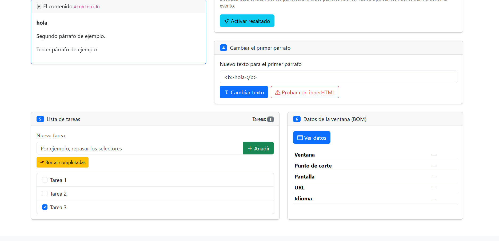

# Tarea 5 · Manipular el DOM

**Autor:** Miguel Ángel Fernández Vega · Desarrollo Web en Entorno Cliente (DWEC) · 2.º DAW · Curso 2026-27

Página con seis ejercicios que leen y cambian el DOM con JavaScript: selectores, crear y borrar nodos, eventos del ratón, `textContent` frente a `innerHTML`, una lista de tareas y los datos del BOM. Para probarla, abrir `index.html` en el navegador (o con **Go Live** en VS Code) y usar los botones con la consola abierta (F12).

## Capturas

### a) La página recién cargada

La página recién cargada: mi nombre en la navbar y los tres párrafos de partida dentro de `#contenido`, sin ningún cambio todavía.

### b) Ejercicios 1 y 2

Tras pulsar «Aplicar cambios»: el primer párrafo cambia de texto (`getElementById`), el segundo se resalta con `bg-warning-subtle` (`querySelector` y `.segundo`) y el tercero se pone en rojo con `text-danger` (`querySelectorAll` y la posición `[2]`). Los párrafos añadidos con el ejercicio 2 y el aviso de «no quedan párrafos» se ven en la captura c.

### c) Ejercicio 3: resaltado al pasar el ratón

El ratón está sobre «Párrafo nuevo 2», que se pone gris con `bg-body-secondary` (`mouseenter`) y vuelve a la normalidad al salir (`mouseleave`). Hay que volver a pulsar «Activar resaltado» después de añadir párrafos porque `querySelectorAll` recoge solo los párrafos que existen en ese momento: los nuevos no tienen los eventos hasta que se recorre otra vez la lista.

### d) Ejercicio 4: `<b>hola</b>` con innerHTML

Con `<b>hola</b>` escrito en la casilla, «Cambiar texto» (`textContent`) muestra las etiquetas tal cual, mientras que «Probar con innerHTML» las interpreta y el párrafo muestra **hola** en negrita, como se ve aquí.

### e) Ejercicio 5: la lista de tareas

Lista con tres tareas, la tercera marcada, antes de pulsar «Borrar completadas». El contador de la cabecera marca 3.

### f) Ejercicio 6: los datos de la ventana en el móvil

Datos en el modo dispositivo de F12, con una ventana de 718 × 646 px: punto de corte **sm**, idioma `es` y la URL del archivo local. En mi ordenador, con la ventana maximizada, sale **xxl**.

## Reflexión

`textContent` trata lo que recibe como texto plano: si escribo `<b>hola</b>`, en la página aparecen las etiquetas tal cual, con sus símbolos `<` y `>`. `innerHTML`, en cambio, interpreta ese texto como HTML: con el mismo `<b>hola</b>` el navegador crea un elemento `<b>` y el párrafo muestra «hola» en negrita, como se ve en la captura d. Esa diferencia es el problema, porque lo que escribe el usuario puede ser código y no solo texto. Si se mete en `innerHTML` algo como ``, el navegador ejecutaría ese JavaScript dentro de mi página (un ataque XSS) y podría robar datos o cambiar lo que ve otra persona. Por eso uso `textContent` siempre que el texto lo escribe el usuario, como en `cambiarTexto()` y en el `` de cada tarea, y dejo `innerHTML` solo para HTML que escribo yo.

## Fuentes

- [Node.textContent · MDN](https://developer.mozilla.org/es/docs/Web/API/Node/textContent)
- [Element.innerHTML · MDN](https://developer.mozilla.org/es/docs/Web/API/Element/innerHTML)
- [Document.querySelector() · MDN](https://developer.mozilla.org/es/docs/Web/API/Document/querySelector)
- [EventTarget.addEventListener() · MDN](https://developer.mozilla.org/es/docs/Web/API/EventTarget/addEventListener)
- [Breakpoints · Bootstrap 5.3](https://getbootstrap.com/docs/5.3/layout/breakpoints/)

## Uso de IA

He usado Claude (Anthropic) para escribir y entender las funciones de `app.js`, con la explicación de cada una, para revisar el proyecto frente al enunciado y para redactar un borrador de este README. Después estudie e introduge el código en `app.js`, corregí los comentarios y los restos de la plantilla, hice las seis capturas en mi equipo y repasé las explicaciones para poder defender el código en clase. He utilizado un uso que considero abusivo de la IA porque pensaba que este trabajo era para el viernes, ten esto en cuenta y preguntame con 