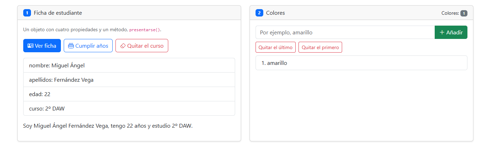
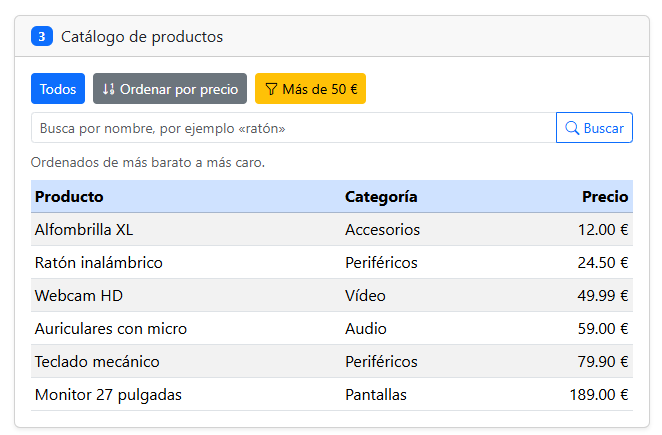
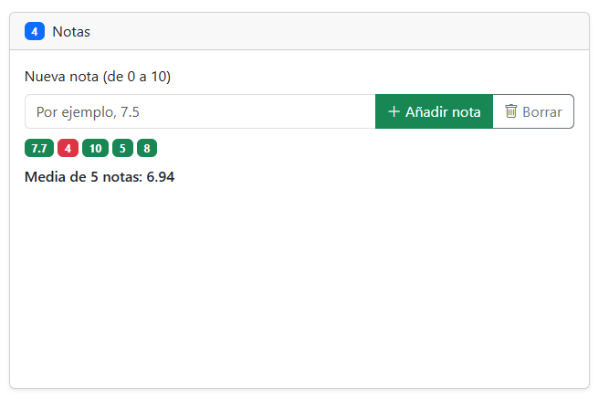
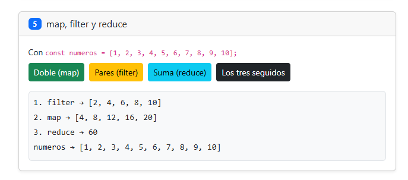
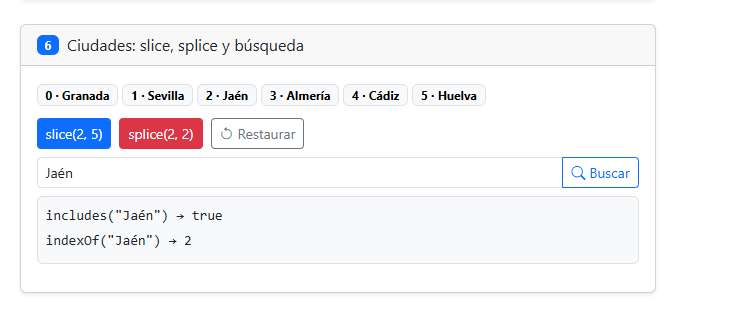

# Tarea 6 · Objetos y arrays

**Autor:** Miguel Ángel Fernández Vega · Desarrollo Web en Entorno Cliente (DWEC) · 2.º DAW · Curso 2026-27

Esta carpeta contiene la página «Objetos y arrays», con seis ejercicios, uno por tarjeta. Para probarla, abro la carpeta en VS Code, pulso **Go Live** y uso los botones con la consola abierta (F12).

## Capturas

### a) La página recién cargada

Se ve mi nombre en la navbar, los tres colores de partida (rojo, verde y azul) con su contador, la tabla con los seis productos y las ocho ciudades con su posición.

### b) Ejercicios 1 y 2: la ficha y los colores

La ficha después de pulsar «Cumplir años»: la edad ha subido de 21 a 22 y la frase de `presentarse()` también. En los colores he añadido uno con `push()` y he quitado otros con `pop()` (el último) y `shift()` (el primero). El contador se actualiza cada vez.

**Qué sale en el curso después de borrarlo y por qué:** al pulsar «Quitar el curso» se ejecuta `delete estudiante.curso` y la propiedad desaparece del objeto. Aun así, la lista sigue mostrando la línea `curso: undefined`, porque `verFicha()` recorre el array de claves `["nombre", "apellidos", "edad", "curso"]`, que no cambia con el `delete`. Cuando se lee una propiedad que no existe, JavaScript no da error, sino que devuelve `undefined`. Por eso la frase de `presentarse()` acaba en «estudio undefined».

### c) Ejercicio 3: el catálogo ordenado por precio

La función de comparación es `function (a, b) { return a.precio - b.precio; }`: si el resultado es negativo, `a` va antes que `b`, así que quedan de más barato a más caro. Ordeno una copia (`[...productos]`) porque `sort()` modifica el array sobre el que se llama. Si ordenara `productos`, el botón «Todos» ya no mostraría el orden original.

### d) Ejercicio 4: las notas y la media

He añadido cinco notas (7.5, 4, 9, 5 y 3.25): las de 5 o más salen en verde y las suspensas en rojo. Debajo aparece la media con dos decimales, calculada con `reduce()`: 5.75.

### e) Ejercicio 5: los tres métodos seguidos

Primero `filter()` se queda con los pares (`[2, 4, 6, 8, 10]`), después `map()` los dobla (`[4, 8, 12, 16, 20]`) y al final `reduce()` suma esos dobles. El resultado es 60. El array `numeros` sigue siendo el original.

### f) Ejercicio 6: después de splice y de buscar una ciudad

`splice(2, 2)` ha quitado Málaga y Córdoba, y el array ha pasado de 8 a 6 ciudades. He buscado «Jaén»: `includes()` devuelve `true` e `indexOf()` devuelve 2. Antes del `splice` estaba en la posición 4, pero al desaparecer dos ciudades anteriores, las siguientes se desplazan dos posiciones hacia el principio.

## Reflexión

Los métodos `push`, `pop`, `shift`, `splice` y `sort` cambian el array original, mientras que `slice`, `map` y `filter` devuelven uno nuevo y no tocan el original (`reduce` devuelve un solo valor). En el ejercicio 6, `slice(2, 5)` devuelve `[Málaga, Córdoba, Jaén]` y `ciudades` sigue teniendo 8 elementos. En cambio, `splice(2, 2)` devuelve las dos ciudades quitadas y `ciudades` se queda con 6. Por eso, para restaurar, copio `ciudadesOriginal` con `[...ciudadesOriginal]`: si hiciera `ciudades = ciudadesOriginal`, los dos nombres apuntarían al mismo array y el siguiente `splice` estropearía también el original. Por la misma razón, en el ejercicio 3 ordeno una copia: así `productos` conserva su orden inicial.

## Fuentes

- [Array.prototype.splice() · MDN](https://developer.mozilla.org/es/docs/Web/JavaScript/Reference/Global_Objects/Array/splice)
- [Array.prototype.slice() · MDN](https://developer.mozilla.org/es/docs/Web/JavaScript/Reference/Global_Objects/Array/slice)
- [Array.prototype.sort() · MDN](https://developer.mozilla.org/es/docs/Web/JavaScript/Reference/Global_Objects/Array/sort)
- [Array.prototype.reduce() · MDN](https://developer.mozilla.org/es/docs/Web/JavaScript/Reference/Global_Objects/Array/reduce)

## Uso de IA

He usado Claude (Anthropic) como apoyo durante toda la tarea. Le pedí explicaciones de cada ejercicio, que me señalara errores de mi código (erratas como `getElementeById` o `textCotent`, llaves y comas mal puestas, el rango de la nota) y que revisara el resultado contra el enunciado. La redacción de este README parte de un borrador de Claude que he revisado y ajustado a mis capturas.